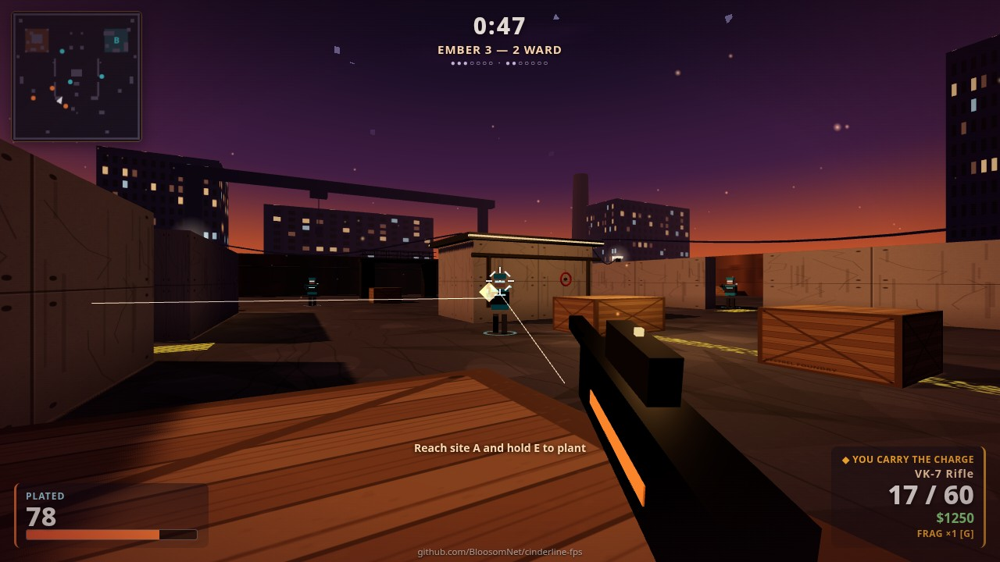
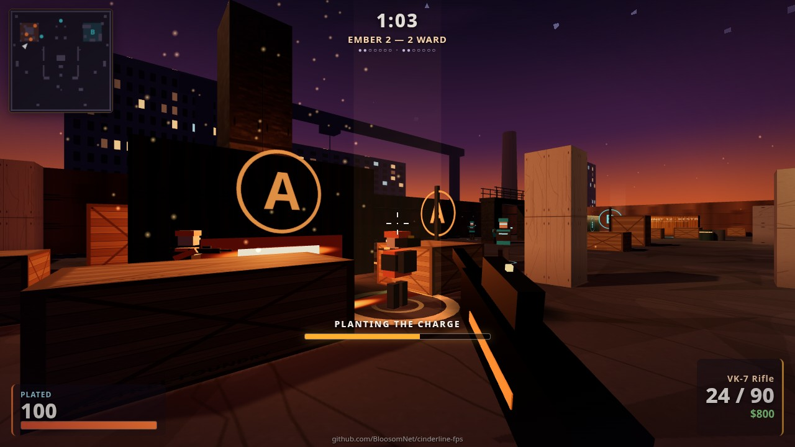
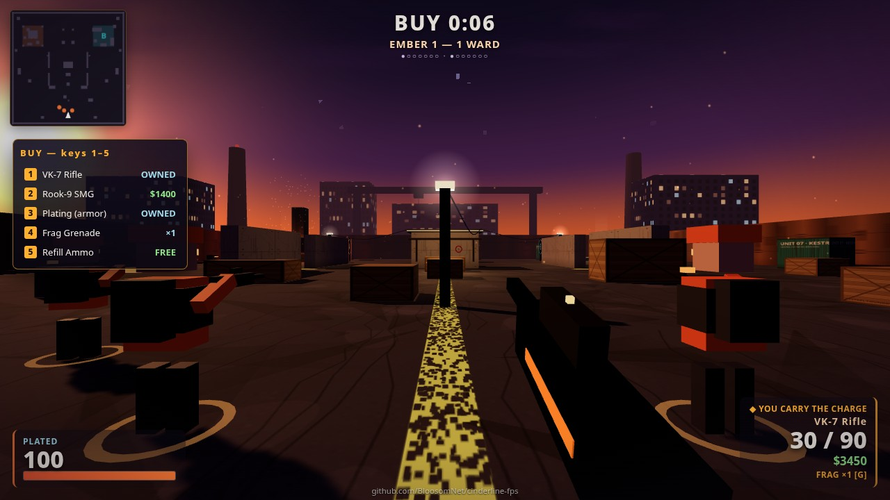
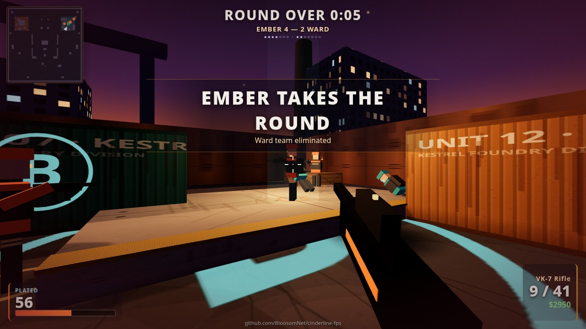

# CINDERLINE

Game FPS taktis berbasis ronde yang berjalan sepenuhnya di browser, dibangun dengan Three.js dan JavaScript murni.

## Tentang Game Ini

CINDERLINE dibuat sebagai entri untuk kompetisi **threejs-fps-01 di make.fun**, sebuah kompetisi membangun game FPS berbasis Three.js.

Pemain bergabung dengan tim **Ember** (pemain + 3 bot rekan) melawan tim **Ward** (4 bot) di sebuah foundry pada waktu senja. Misi tim Ember adalah memasang breach charge di situs A atau situs B dan menjaganya sampai meledak, sementara tim Ward berusaha menggagalkan atau menjinakkannya. Pertandingan berjalan dalam format ronde: tim pertama yang memenangkan 7 ronde keluar sebagai pemenang (maksimal 12 ronde).

## Fitur

- 3 senjata: pistol, SMG, dan rifle, masing-masing dengan recoil dan pola penyebaran peluru sendiri
- Akurasi dipengaruhi gerakan: menembak sambil berlari kurang akurat, jongkok atau diam membuat bidikan lebih rapat
- Sistem ekonomi dan menu beli di awal ronde
- Granat frag
- Bot lawan dan rekan dengan persepsi melihat dan mendengar
- HUD lengkap dengan minimap
- Kontrol sentuh untuk layar HP

## Cara Main

Cara paling mudah: unduh file `cinderline.html`, lalu buka di browser. Seluruh game ada di dalam satu file itu dan tidak membutuhkan koneksi internet.

Untuk menjalankan versi kode sumbernya, layani folder `game/` dengan static server apa pun (misalnya `npx serve game`), lalu buka alamatnya di browser.

## Kontrol

| Tombol | Fungsi |
| --- | --- |
| WASD | Bergerak |
| Mouse | Melihat sekeliling |
| Klik kiri | Menembak |
| R | Reload |
| Shift | Jongkok |
| Space | Lompat |
| G | Lempar granat frag |
| E | Memasang charge (di dalam situs) |

## Teknologi

- Three.js (disertakan di `game/vendor/three/`, lisensi MIT dari Three.js)
- JavaScript ES modules tanpa proses build untuk versi sumber
- Web Audio API untuk efek suara

## Struktur Repo

- `cinderline.html` — build satu file, langsung bisa dimainkan
- `game/` — kode sumber game (`index.html` + folder `src/`)
- `screenshots/` — tangkapan layar gameplay

## Tangkapan Layar

